# Keynote Presentation: Bring the AI Agent to Your Laptop as Your Research Partner

**Multiple agents, cross-checked — then build your own Skill.**

> 📥 **Download PowerPoint Slides (.pptx)**: <https://reurl.cc/5XjzlG>
> 💡 Use the **interactive slide player** below (supports **← / → arrow keys**) or scroll down to read the full 5-part web version with embedded demo videos and speaker notes.

<!-- DECK_PLAYER -->

---

## Part 1: Opening & NCHC Supercomputers in the Age of AI Agents (Slides 1–6)

### Slide 1 · Bring the AI Agent to Your Laptop as Your Research Partner

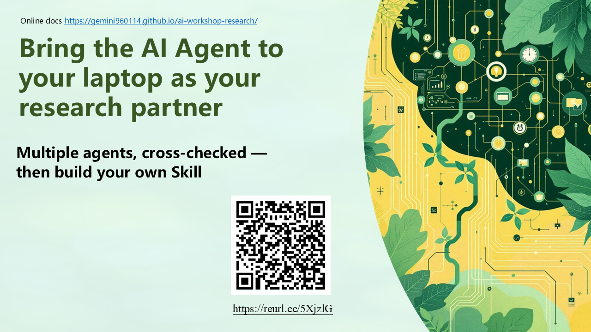

> 🎙️ **Speaker Notes**:
> Hello everyone, and welcome. Today's idea is simple: bring an AI agent onto your own laptop and let it be your research partner. One habit goes with it: use more than one agent and let them cross-check each other. At the end, you will turn what works into a Skill of your own. The link at the top opens the course website, and the QR code lets you download the slides.

---

### Slide 2 · About the Speaker

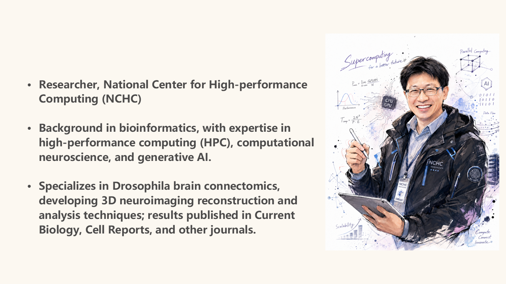

- **Researcher, National Center for High-performance Computing (NCHC)**
- Background in bioinformatics, with expertise in high-performance computing (HPC), computational neuroscience, and generative AI.
- Specializes in *Drosophila* brain connectomics, developing 3D neuroimaging reconstruction and analysis techniques; results published in *Current Biology*, *Cell Reports*, and other journals.

> 🎙️ **Speaker Notes**:
> A quick introduction. I am a researcher at NCHC, Taiwan's national supercomputing center. My background is bioinformatics, and my work covers high-performance computing, computational neuroscience, and generative AI. I study the fruit fly brain and build 3D tools to reconstruct and analyze its neurons. What I share today is meant to be practical for researchers.

---

### Slide 3 · About NCHC


> 🎙️ **Speaker Notes**:
> NCHC was founded in 1991. We run Taiwan's shared computing platform and the academic research network. Our core technologies are high-performance computing, cloud, cybersecurity, AI, and data analysis. Our slogan is 'From Enabler to Enhancer': supercomputers are the spark of research, and they help teams across Taiwan get their best results.

---

### Slide 4 · NCHC HPC Cluster Systems


> 🎙️ **Speaker Notes**:
> These are our supercomputer clusters. Taiwania 2 started in 2018 and ranked number 20 on the Top500 list. Taiwania 3 came in 2020, Forerunner 1 in 2023, and Nano 5 in 2025. Each system has a different role, and Nano 5 reaches about 13 PFLOPS. You do not need to remember the numbers. The point is that we have real, large machines for researchers.

---

### Slide 5 · NCHC Nano4 System (Jingchuang 26)

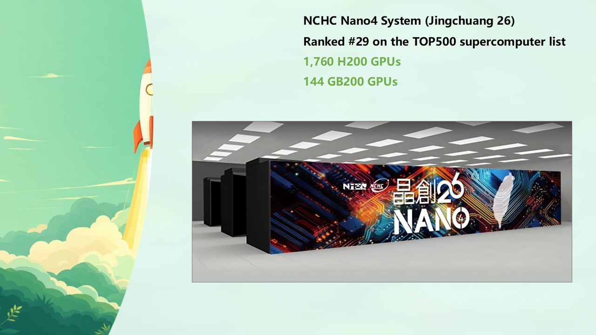

- **Ranked #29 on the TOP500 supercomputer list**
- **1,760 H200 GPUs**
- **144 GB200 GPUs**

> 🎙️ **Speaker Notes**:
> Here is Nano4. It ranked number 29 on the TOP500 list. It has 1,760 H200 GPUs and 144 GB200 GPUs. Here is why this matters today: this much computing power can now be controlled by an AI agent, using plain language.

---

### Slide 6 · In the Age of AI Agents, What Can Supercomputers Do for Physicians and Researchers?

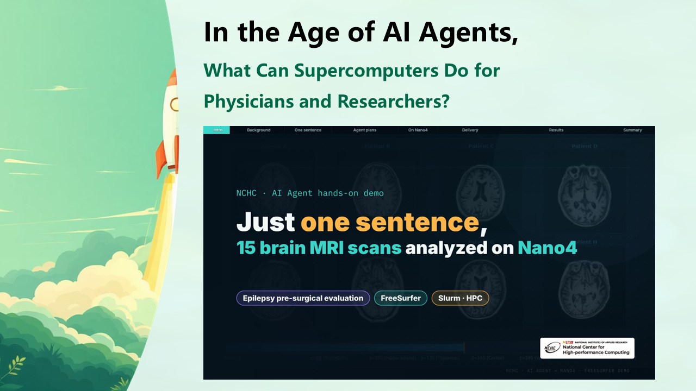

#### 🎬 Demo Video: 1 Sentence, 15 Brain MRI Scans Analyzed on Nano4 (Epilepsy Pre-Surgical Evaluation · FreeSurfer · Slurm)

<!-- NANO4_VIDEO -->

> 🎙️ **Speaker Notes**:
> Let's watch a short demo. A researcher gives one sentence to an AI agent. The agent then analyzes 15 brain MRI scans on Nano4. This is for epilepsy pre-surgical evaluation, and it uses FreeSurfer and the Slurm scheduler on the supercomputer. The researcher does not write the commands by hand. Please watch how much the agent does for them.

---

## Part 2: What Is Generative AI? Word Chain, Tokens & Hallucinations (Slides 7–12)

### Slide 7 · What Is Generative AI?

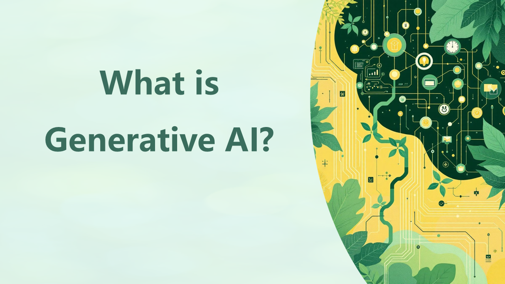

> 🎙️ **Speaker Notes**:
> Before we talk about agents, let's understand the engine underneath: generative AI. In one sentence, it is a very powerful word-chain game. Let me show you how it works.

---

### Slide 8 · Word Chain (Next Token Prediction)

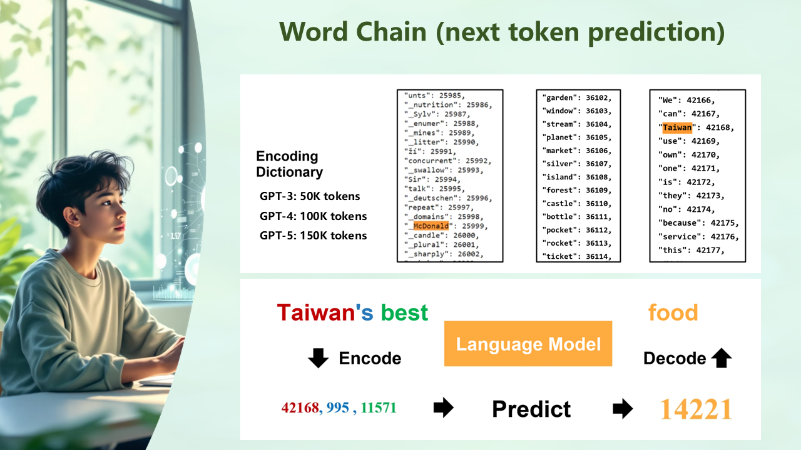

> 🎙️ **Speaker Notes**:
> Computers cannot read words, only numbers. So every word is turned into a number using a dictionary. These pieces are called tokens. GPT-3's dictionary has about 50 thousand tokens, GPT-4 about 100 thousand, and GPT-5 about 150 thousand. In this example, 'Taiwan's best' becomes three numbers. The model predicts the next number, 14221, and we decode it back into a word: 'food'.

---

### Slide 9 · Generative AI Creates Content by Word Chain!


> 🎙️ **Speaker Notes**:
> So generative AI answers by playing word chain. We ask, 'What is Taiwan's tallest mountain?' The model predicts 'Yu'. We add 'Yu' to the question and ask again. It predicts 'shan'. We add it again, and now it predicts END, so it stops. It writes one small piece at a time.

---

### Slide 10 · Why Are the Answers Different Every Time?


> 🎙️ **Speaker Notes**:
> At each step, the model does not have just one choice. It scores thousands of possible next words. The bars show how likely each word is. Then the model rolls a dice among the likely ones. So the answer could start with 'Yu', 'It', or 'The'.

---

### Slide 11 · Why Answers Differ Every Time and May Include Hallucinations

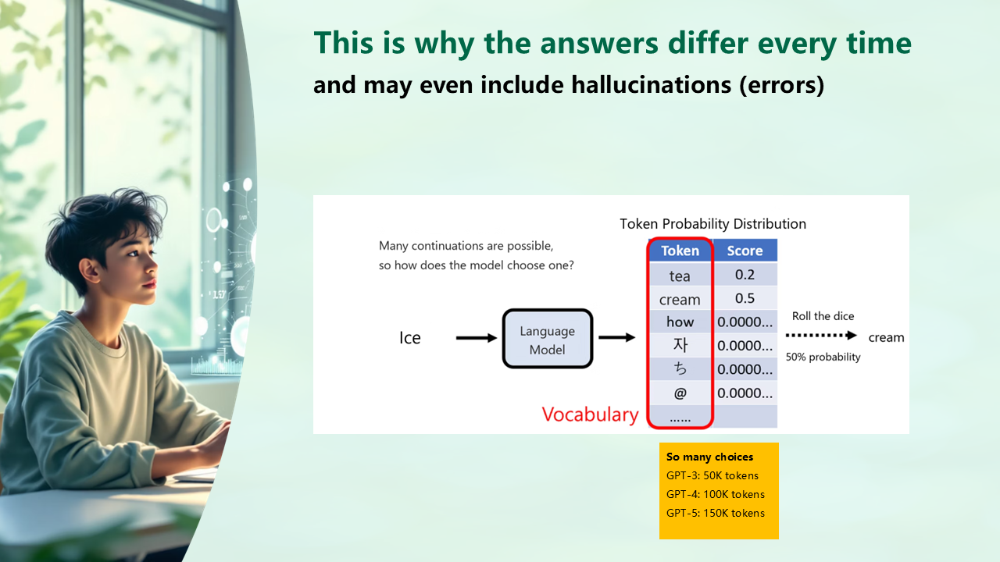

> 🎙️ **Speaker Notes**:
> This is why the answer is different every time. It is also why mistakes can appear. We call them hallucinations. One unlucky word can be chosen, and every later word follows it. The lesson is simple: AI sounds confident, but we must check its work.

---

### Slide 12 · Artificial Analysis Intelligence Index (2026-11-12)


> 🎙️ **Speaker Notes**:
> How do we know which AI is good? This chart ranks many models with one independent index, dated 2026-11-12. Notice that the top scores come from a few different companies, and they are close to each other. Open-weight models, whose weights anyone can download, sit a bit lower. There is no single winner for every job. Keep this in mind for later: use more than one model.

---

## Part 3: What Is Agentic AI? Brain + Tools = AI Agent (Slides 13–15)

### Slide 13 · So What Is Agentic AI?


> 🎙️ **Speaker Notes**:
> Now the second big idea: Agentic AI. A chatbot only talks. An agent can also act: it can read files, run programs, and check the results. Let's see how it is built.

---

### Slide 14 · What Is Agentic? Brain + Tools = AI Agent


> 🎙️ **Speaker Notes**:
> Think of Iron Man. Tony Stark is the brain. The Iron Man suit gives him tools and power. Together they make a hero. In AI, ChatGPT is the brain, and Codex is the suit. The suit lets the brain open files, run code, and fix its own mistakes. The agent works in a loop: think, use a tool, look at the result, and think again. Brain plus tools makes an agent.

---

### Slide 15 · Three Agentic Tools: Don't Trust Just One


| Brain (LLM) | Suit (Agentic Tool) | Superhero Analogy |
| --- | --- | --- |
| **ChatGPT** | **Codex** | 🦾 Iron Man |
| **Gemini** | **Antigravity** | 🛡️ Captain America |
| **Claude** | **Claude Code** | 🔮 Doctor Strange |

> 🎙️ **Speaker Notes**:
> There are three big families. Each one pairs a brain with a suit, just like the superheroes on this slide. ChatGPT with Codex is Iron Man. Gemini with Antigravity is Captain America. Claude with Claude Code is Doctor Strange. Each hero has strengths and blind spots. So here is our rule for this course: do not trust just one hero. Let one agent do the work and let another agent check it.

---

## Part 4: Bring the Agent's Brain into Your Laptop — Unit 00 (Slides 16–17)

### Slide 16 · How Can These AI Agents Do Research with You?


> 🎙️ **Speaker Notes**:
> Remember the demo at the start: one sentence, and an agent analyzed 15 brain MRI scans. That is research work. Researchers read papers, analyze data, write reports, and check the results. So the question is: how can these agents work with you on that, on your own laptop? Two ideas. First, bring the agent's brain to your laptop. Second, use more than one agent. Let me show you a simple example.

---

### Slide 17 · Unit 00 | Cloud vs. Local: One Paper, Two Ways to Use AI

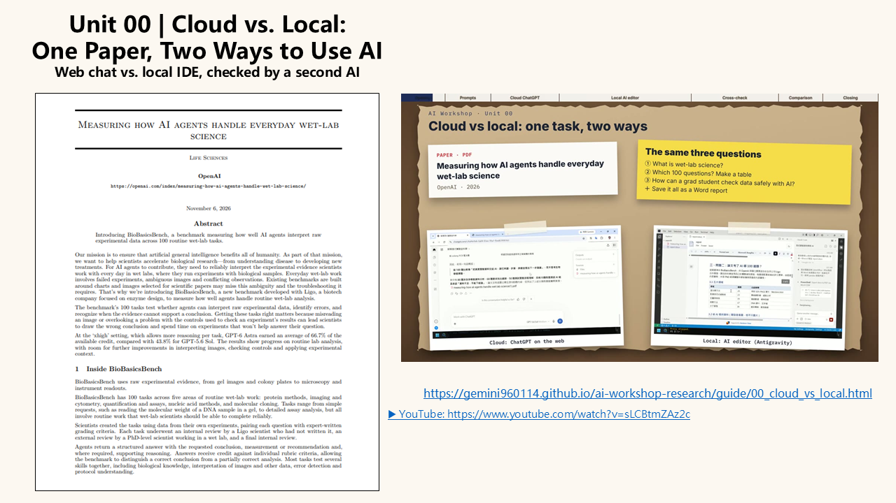

- 📖 **Written Guide**: [Open Unit 00: Cloud vs. Local](00-ai-workshop-openai/)
- 🎬 **YouTube Video**: <https://www.youtube.com/watch?v=sLCBtmZAz2c>

<iframe style="width:100%;aspect-ratio:16/9;border-radius:8px;margin:12px 0;border:0;" src="https://www.youtube.com/embed/sLCBtmZAz2c" title="Unit 00 | Cloud vs. Local" allow="accelerometer; autoplay; clipboard-write; encrypted-media; gyroscope; picture-in-picture" allowfullscreen></iframe>

> 🎙️ **Speaker Notes**:
> This is Unit 00: one paper, two ways to use AI. Way one is ChatGPT on the web. Way two is an AI editor, an IDE, on my own laptop. I ask the same three questions in both. Then a second agent, Gemini, checks the report. Please watch the video to see how the two ways compare, and how the second agent catches problems. This is the habit we want: one agent works, another agent checks. Unit 00 showed the habit. Next, let me show you the full learning path.

#### 📋 Unit 00 Live Demo Prompts

```text
# ChatGPT Web and Local Claude Code
What does "wet-lab science" in this paper's title mean? Why would AI need to handle lab work?

It says 100 lab questions were used to test the AI. What kinds of questions are they? Multiple choice or image-based? Please put it in a simple table.

I'm a graduate student who just joined a biology lab. How can I safely use AI to check my experimental data without being misled?

Please compile the questions and answers above into a Word report named report.docx
```

```text
# Switch to Gemini for Cross-Checking
report.docx is the AI agent's write-up of the questions and answers based on measuring-how-ai-agents-handle-wet-lab-science.pdf. Please check whether it is correct.

Revise it according to your suggestions and save it under a new file name
```

---

## Part 5: From Tool to Skill — Your Learning Path & Units 01–04 (Slides 18–23)

### Slide 18 · 🧭 Your Learning Path (`From Tool to Skill · Units 01–04`)


1. **[Unit 01 · Getting Started with Antigravity](01-ai-workshop-agy/)** (`TOOL`) — The tool: an AI agent you talk to in plain language.
2. **[Unit 02 · Frontend Design](02-ai-workshop-frontend-design/)** (`SKILL`) — Use a skill: same request, a better-designed result.
3. **[Unit 03 · Office Document Processing](03-ai-workshop-office-skills/)** (`MORE SKILLS`) — More skills: one CSV becomes Excel, slides, Word, and PDF.
4. **[Unit 04 · Voucher OCR to Excel](04-ai-workshop-voucher-ocr/)** (`BUILD`) — Turn a working workflow into a skill. Bonus: two agents check each other.

> 🎙️ **Speaker Notes**:
> Here is the path for the rest of the course. We start with the tool: Unit 01, an agent you talk to in plain language. Then skills. In Unit 02 we add one skill and see the result get better. In Unit 03 we use four skills for office documents. In Unit 04 we build a skill from a workflow that works, and in the bonus part two agents check each other. All along, the habit from Unit 00 stays the same: one agent works, another agent checks. Everything is on the course website, with a written guide and a video for each unit.

---

### Slide 19 · 🧰 Unit 01 | Getting Started with Antigravity (`Step 1 of 4 · The Tool`)


- 📖 **Written Guide**: [Open Unit 01: Getting Started with Antigravity](01-ai-workshop-agy/)
- 🎬 **YouTube Video**: <https://youtu.be/72oCyg8MDLg>

<iframe style="width:100%;aspect-ratio:16/9;border-radius:8px;margin:12px 0;border:0;" src="https://www.youtube.com/embed/72oCyg8MDLg" title="Unit 01 | Getting Started with Antigravity" allow="accelerometer; autoplay; clipboard-write; encrypted-media; gyroscope; picture-in-picture" allowfullscreen></iframe>

> 🎙️ **Speaker Notes**:
> Unit 01 is the tool. We install Antigravity, an editor with a built-in AI agent. You chat in plain language, with no coding needed. By the end, you have built a web page and a small game. The video shows every step.

---

### Slide 20 · 🎨 Unit 02 | Frontend Design (`Step 2 of 4 · Skills`)

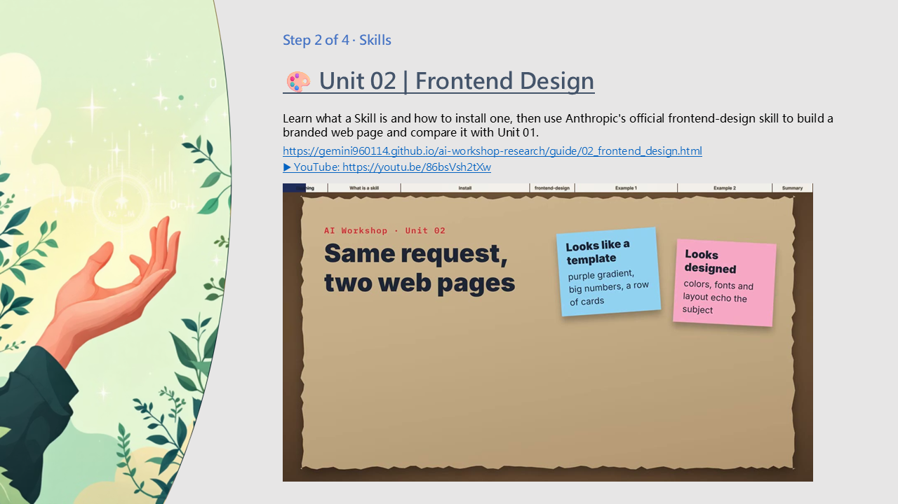

- 📖 **Written Guide**: [Open Unit 02: Frontend Design](02-ai-workshop-frontend-design/)
- 🎬 **YouTube Video**: <https://youtu.be/86bsVsh2tXw>

<iframe style="width:100%;aspect-ratio:16/9;border-radius:8px;margin:12px 0;border:0;" src="https://www.youtube.com/embed/86bsVsh2tXw" title="Unit 02 | Frontend Design" allow="accelerometer; autoplay; clipboard-write; encrypted-media; gyroscope; picture-in-picture" allowfullscreen></iframe>

> 🎙️ **Speaker Notes**:
> Unit 02 is about skills. A skill is a set of instructions that teaches an agent how to do a job well. We install Anthropic's frontend-design skill and ask for the same web page again. Compare it with Unit 01: same request, but now the page looks designed instead of looking like a template.

---

### Slide 21 · 📄 Unit 03 | Office Document Processing (`Step 3 of 4 · More Skills`)


- 📖 **Written Guide**: [Open Unit 03: Office Document Processing](03-ai-workshop-office-skills/)
- 🎬 **YouTube Video**: <https://youtu.be/sOIg3osiPU4>

<iframe style="width:100%;aspect-ratio:16/9;border-radius:8px;margin:12px 0;border:0;" src="https://www.youtube.com/embed/sOIg3osiPU4" title="Unit 03 | Office Document Processing" allow="accelerometer; autoplay; clipboard-write; encrypted-media; gyroscope; picture-in-picture" allowfullscreen></iframe>

> 🎙️ **Speaker Notes**:
> Unit 03 is office documents. We use four official skills: docx, pdf, pptx, and xlsx. We start with one CSV file and end with an Excel workbook, slides, a Word report, and a PDF handout. This can save you hours on routine paperwork.

---

### Slide 22 · 🧾 Unit 04 | Voucher OCR to Excel (`Step 4 of 4 · Build Your Own Skill`)

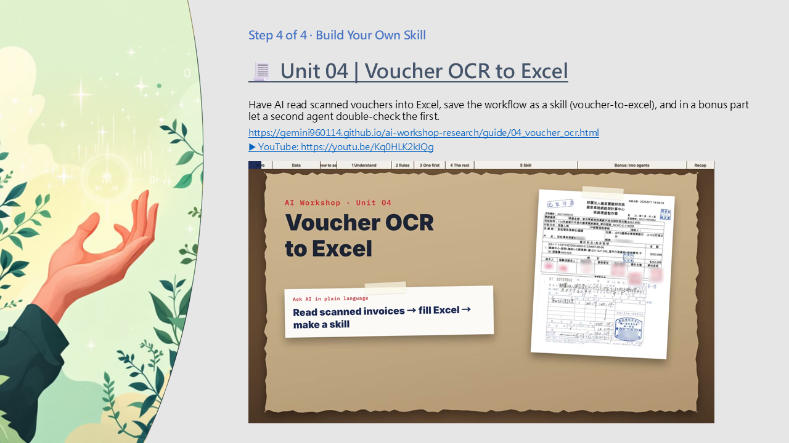

- 📖 **Written Guide**: [Open Unit 04: Voucher OCR to Excel](04-ai-workshop-voucher-ocr/)
- 🎬 **YouTube Video**: <https://youtu.be/Kq0HLK2kIQg>

<iframe style="width:100%;aspect-ratio:16/9;border-radius:8px;margin:12px 0;border:0;" src="https://www.youtube.com/embed/Kq0HLK2kIQg" title="Unit 04 | Voucher OCR to Excel" allow="accelerometer; autoplay; clipboard-write; encrypted-media; gyroscope; picture-in-picture" allowfullscreen></iframe>

> 🎙️ **Speaker Notes**:
> Unit 04 is voucher OCR to Excel. You give the agent a scanned voucher. It reads the voucher and fills in an Excel sheet. When it works, we save the steps as our own skill, so next time one sentence does the whole job. There is also a bonus part with two agents: a second agent double-checks the first. That is our cross-check habit again. Now you can use the same pattern to build skills for your own research.

---

### Slide 23 · Thank You for Your Attention & Q&A

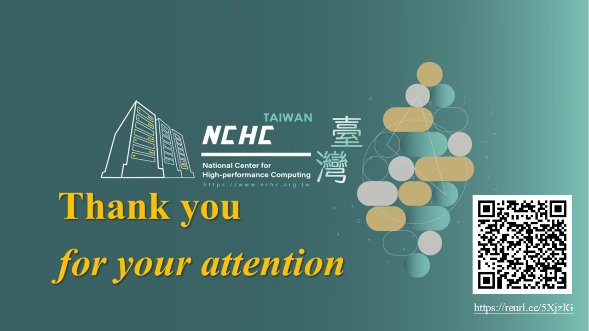

- 📥 **Download Slides (.pptx)**: <https://reurl.cc/5XjzlG>

> 🎙️ **Speaker Notes**:
> Thank you for listening. If you remember only one thing today, remember this: use more than one agent, and always check the result. Scan the QR code to download the slides, and now let's take your questions.
