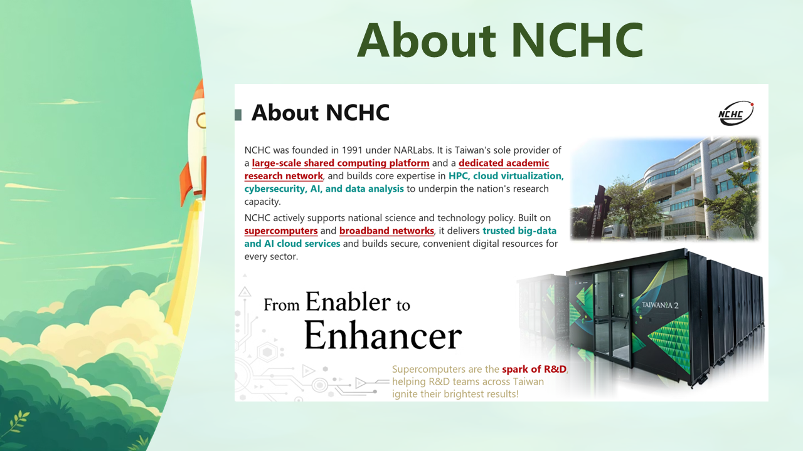
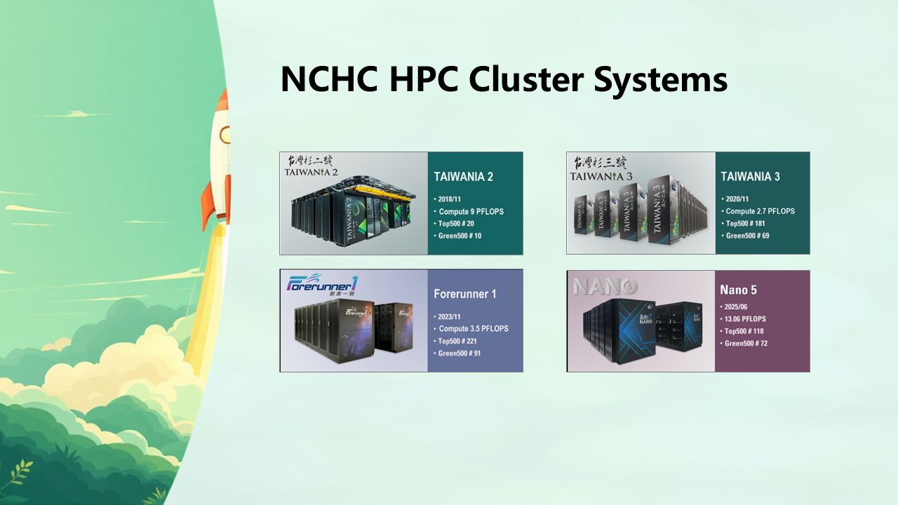
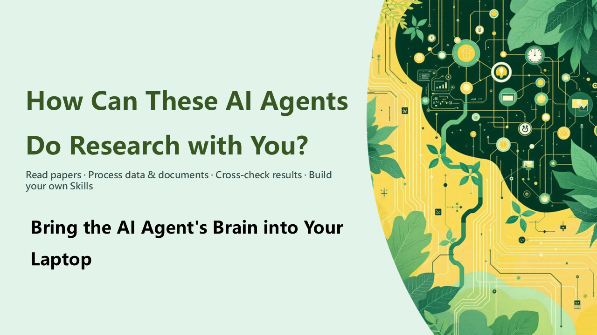
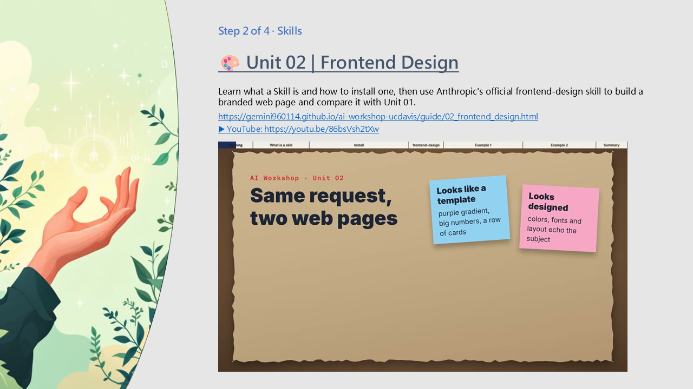
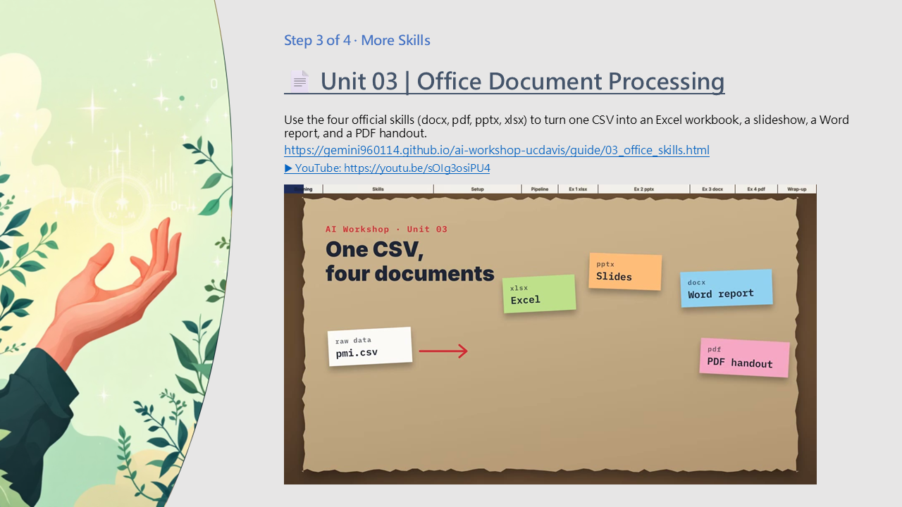
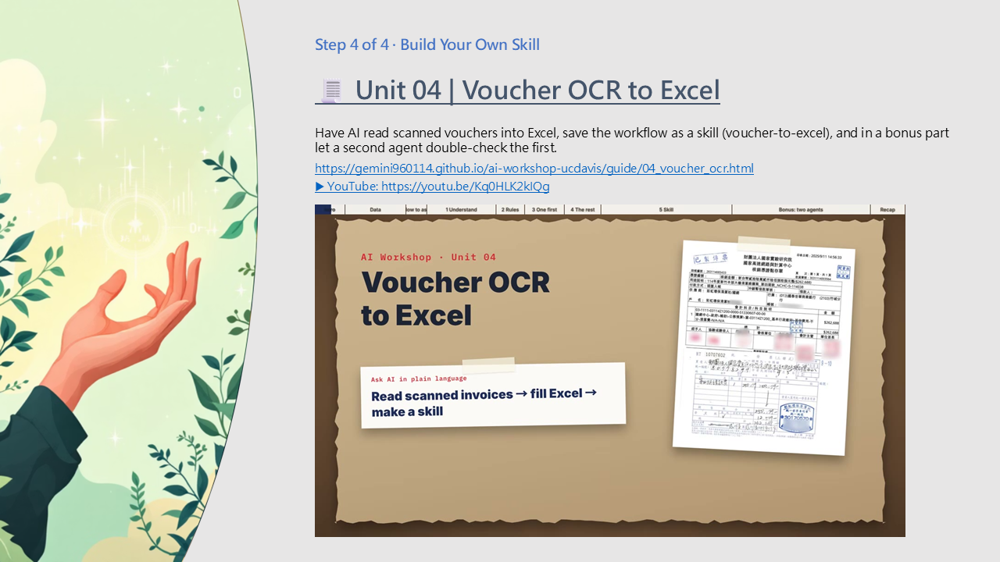

# Keynote Presentation: Bring the AI Agent to Your Laptop as Your Research Partner

**Multiple agents, cross-checked — then build your own Skill.**

> 📥 **Download PowerPoint Slides (.pptx)**: [Bring-the-AI-Agent-to-your-laptop-as-your-research-partner.pptx](https://github.com/gemini960114/ai-workshop-ucdavis/raw/main/PPTX/Bring-the-AI-Agent-to-your-laptop-as-your-research-partner.pptx) (or via [Google Drive](https://reurl.cc/5XjzlG))
> 💡 Use the **interactive 16-slide player** below (supports **← / → arrow keys**) or scroll down to read the full 5-part web version with embedded explainer videos, demo videos, and demo prompts.

<!-- DECK_PLAYER -->

---

## Part 1: Opening & NCHC Supercomputers in the Age of AI Agents (Slides 1–4)

### Slide 1 · Bring the AI Agent to Your Laptop as Your Research Partner


Hello everyone, and welcome. Today's idea is simple: bring an AI agent onto your own laptop and let it be your research partner. One habit goes with it: use more than one agent and let them cross-check each other. At the end, you will turn what works into a Skill of your own. The link at the top opens the course website, and the QR code lets you download the slides.

---

### Slide 2 · About the Speaker


- **Researcher, National Center for High-performance Computing (NCHC)**
- Background in bioinformatics, with expertise in high-performance computing (HPC), computational neuroscience, and generative AI.
- Specializes in *Drosophila* brain connectomics, developing 3D neuroimaging reconstruction and analysis techniques; results published in *Current Biology*, *Cell Reports*, and other journals.

A quick introduction. I am a researcher at NCHC, Taiwan's national supercomputing center. My background is bioinformatics, and my work covers high-performance computing, computational neuroscience, and generative AI. I study the fruit fly brain and build 3D tools to reconstruct and analyze its neurons. What I share today is meant to be practical for researchers.

---

### Slide 3 · About NCHC



NCHC was founded in 1991. We run Taiwan's shared computing platform and the academic research network. Our core technologies are high-performance computing, cloud, cybersecurity, AI, and data analysis. Our slogan is 'From Enabler to Enhancer': supercomputers are the spark of research, and they help teams across Taiwan get their best results.

---

### Slide 4 · In the Age of AI Agents, What Can Supercomputers Do for Physicians and Researchers?



#### 🎬 Demo Video: 1 Sentence, 15 Brain MRI Scans Analyzed on Nano4 (Epilepsy Pre-Surgical Evaluation · FreeSurfer · Slurm)

<!-- NANO4_VIDEO -->

NCHC provides supercomputers to physicians, scientists, and researchers. Here is an example of what they can do with an AI agent. A researcher gives just one sentence, and the agent analyzes 15 brain MRI scans on our Nano4 supercomputer. This is for epilepsy pre-surgical evaluation, using FreeSurfer and the Slurm scheduler. The researcher does not write the commands by hand. Please watch how much the agent does for them.

---

## Part 2: Part 1 of the Agent — Inside the Brain: Generative AI, Word Chain & Hallucinations (Slides 5–6)

### Slide 5 · What Is Generative AI? (`Part 1: Inside the Agent's Brain — and why it can make mistakes`)


#### 🎬 Explainer Video (2:36): Inside the Agent's Brain — Word Chain, Tokens, Probability & Hallucinations

<!-- GENAI_VIDEO -->

You just saw an AI agent analyze 15 brain MRI scans from one sentence. How does that actually work? An AI agent has two parts: a brain that thinks, and tools that act. In this video, we look inside Part 1—the brain, generative AI:

- **Tokens & Encoding Dictionary**: Computers cannot read words, only numbers. Every word is turned into a number using a dictionary (GPT-3 has ~50,000 tokens, GPT-4 ~100,000, and GPT-5 ~150,000). For example, `"Taiwan's best"` becomes three numbers (`42168, 995, 11571`), the language model predicts the next number (`14221`), and we decode it back into `"food"`.
- **Word Chain (Next-Token Prediction)**: When we ask *"What is Taiwan's tallest mountain?"*, the model predicts `"Yu"`, appends it, predicts `"shan"`, and finally predicts `END`.
- **Rolling the Dice & Hallucinations**: At each step, the model scores thousands of candidate words and rolls the dice among the likely ones. That is why answers differ every time—and why an unlucky roll (such as picking `"Ali"` instead of `"Yu"` and confidently writing `"Alishan"`) produces a **hallucination**. AI sounds confident, so we must always check its work.

---

### Slide 6 · Artificial Analysis Intelligence Index (2026-11-12)


Here is the chart from the end of the video, ranking many models with one independent index dated 2026-11-12. Notice that the top scores come from a few different companies, and they are close to each other. Open-weight models, whose weights anyone can download, sit a bit lower. There is no single winner for every job—so remember our rule: use more than one model, and let them check each other.

---

## Part 3: Part 2 of the Agent — Giving the Brain a Suit of Tools to Act (Slides 7–8)

### Slide 7 · So What Is Agentic AI? (`Part 2: Giving the Brain a Suit of Tools to Act`)


#### 🎬 Explainer Video (1:59): Brain + Suit = Agent — How Agentic AI Works in a Loop

<!-- AGENTIC_VIDEO -->

Now we know how the brain works: it plays word chain, and different models have different strengths. But a brain alone—like a web chatbot—only talks. It cannot open your files, run your programs, or check the results.

- **Brain + Suit = Agent**: Think of Iron Man. Tony Stark is the brain, and the Iron Man suit gives him tools and power. In AI, the LLM (such as ChatGPT, Gemini, or Claude) is the brain, and the agentic environment (Codex, Antigravity, or Claude Code) is the suit that lets the brain open files, run code, and fix its own mistakes.
- **The Agent Loop**: You give the agent a request $\rightarrow$ the model thinks and asks *"Do I need a tool?"* $\rightarrow$ if yes, it runs the tool, inspects the result (or error), adjusts, and runs again until the job is done.

---

### Slide 8 · Three Agentic Tools: Don't Trust Just One


| Brain (LLM) | Suit (Agentic Tool) | Superhero Analogy |
| --- | --- | --- |
| **ChatGPT** | **Codex** | 🦾 Iron Man |
| **Gemini** | **Antigravity** | 🛡️ Captain America |
| **Claude** | **Claude Code** | 🔮 Doctor Strange |

Here are the three big families from the video—each pairing a brain with a suit of tools: ChatGPT with Codex is Iron Man, Gemini with Antigravity is Captain America, and Claude with Claude Code is Doctor Strange. Each hero has strengths and blind spots, so do not trust just one hero. In our hands-on units today, we will mainly use Antigravity and Claude Code on your laptop—letting one agent do the work and another agent check it.

---

## Part 4: Bring the Agent's Brain into Your Laptop — Unit 00 (Slides 9–10)

### Slide 9 · How Can These AI Agents Do Research with You?



At the start, we saw an agent run brain MRI analysis on a supercomputer. What about your everyday work on your own laptop? Researchers spend hours reading papers, turning data into Excel sheets and slides, processing routine documents, and checking results. So how can these agents work with you on your laptop? Two ideas. First, bring the agent's brain to your laptop. Second, use more than one agent and turn what works into reusable Skills. Let's start with a simple example in Unit 00.

---

### Slide 10 · Unit 00 | Cloud vs. Local: One Paper, Two Ways to Use AI


- 📖 **Written Guide**: [Open Unit 00: Cloud vs. Local](00-ai-workshop-openai/)
- 🎬 **YouTube Video**: <https://www.youtube.com/watch?v=sLCBtmZAz2c>

<iframe style="width:100%;aspect-ratio:16/9;border-radius:8px;margin:12px 0;border:0;" src="https://www.youtube.com/embed/sLCBtmZAz2c" title="Unit 00 | Cloud vs. Local" allow="accelerometer; autoplay; clipboard-write; encrypted-media; gyroscope; picture-in-picture" allowfullscreen></iframe>

This is Unit 00: one paper, two ways to use AI. Way one is ChatGPT on the web. Way two is an AI editor, an IDE, on my own laptop. I ask the same three questions in both. Then a second agent, Gemini, checks the report. Please watch the video to see how the two ways compare, and how the second agent catches problems. This is the habit we want: one agent works, another agent checks. Unit 00 showed the habit. Next, let me show you the full learning path.

#### 📋 Unit 00 Demo Prompts

```text
# ChatGPT Web and Local Claude Code
What does "wet-lab science" in this paper's title mean? Why would AI need to handle lab work?

It says 100 lab questions were used to test the AI. What kinds of questions are they? Multiple choice or image-based? Please put it in a simple table.

I'm a graduate student who just joined a biology lab. How can I safely use AI to check my experimental data without being misled?

Please compile the questions and answers above into a Word report named report.docx
```

```text
# Switch to Gemini for Cross-Checking
report.docx is the AI agent's write-up of the questions and answers based on measuring-how-ai-agents-handle-wet-lab-science.pdf. Please check whether it is correct.

Revise it according to your suggestions and save it under a new file name
```

---

## Part 5: From Tool to Skill — Your Learning Path & Units 01–04 (Slides 11–16)

### Slide 11 · 🧭 Your Learning Path (`From Tool to Skill · Units 01–04`)


1. **[Unit 01 · Getting Started with Antigravity](01-ai-workshop-agy/)** (`TOOL`) — The tool: an AI agent you talk to in plain language.
2. **[Unit 02 · Frontend Design](02-ai-workshop-frontend-design/)** (`SKILL`) — Use a skill: same request, a better-designed result.
3. **[Unit 03 · Office Document Processing](03-ai-workshop-office-skills/)** (`MORE SKILLS`) — More skills: one CSV becomes Excel, slides, Word, and PDF.
4. **[Unit 04 · Voucher OCR to Excel](04-ai-workshop-voucher-ocr/)** (`BUILD`) — Turn a working workflow into a skill. Bonus: two agents check each other.

Here is the path for the rest of the course. We start with the tool: Unit 01, an agent you talk to in plain language. Then skills. In Unit 02 we add one skill and see the result get better. In Unit 03 we use four skills for office documents. In Unit 04 we build a skill from a workflow that works, and in the bonus part two agents check each other. All along, the habit from Unit 00 stays the same: one agent works, another agent checks. Everything is on the course website, with a written guide and a video for each unit.

---

### Slide 12 · 🧰 Unit 01 | Getting Started with Antigravity (`Step 1 of 4 · The Tool`)


- 📖 **Written Guide**: [Open Unit 01: Getting Started with Antigravity](01-ai-workshop-agy/)
- 🎬 **YouTube Video**: <https://youtu.be/72oCyg8MDLg>

<iframe style="width:100%;aspect-ratio:16/9;border-radius:8px;margin:12px 0;border:0;" src="https://www.youtube.com/embed/72oCyg8MDLg" title="Unit 01 | Getting Started with Antigravity" allow="accelerometer; autoplay; clipboard-write; encrypted-media; gyroscope; picture-in-picture" allowfullscreen></iframe>

Unit 01 is the tool. We install Antigravity, an editor with a built-in AI agent. You chat in plain language, with no coding needed. By the end, you have built a web page and a small game. The video shows every step.

#### 📋 Unit 01 Demo Prompts

```text
# Install Essential Tools
Please help me install Git, uv, and Node.js. Skip any that are already installed, tell me the reason if any fail, and finally list the version of each tool.

# First Web Page
Create a hello.html in this folder that displays "Hello Antigravity" and today's date in large text, then open it in the browser for me.

# Memory Match Game
In this folder, help me build a "Memory Match" card game using the simplest Vite + JS setup: 16 cards arranged randomly; flip two matching cards to clear them, and show move count and timer at the top. When all cards are cleared, display "Congratulations!" and a "Play Again" button. Once finished, start the web server directly and give me the URL so I can click and play.
```

---

### Slide 13 · 🎨 Unit 02 | Frontend Design (`Step 2 of 4 · Skills`)



- 📖 **Written Guide**: [Open Unit 02: Frontend Design](02-ai-workshop-frontend-design/)
- 🎬 **YouTube Video**: <https://youtu.be/86bsVsh2tXw>

<iframe style="width:100%;aspect-ratio:16/9;border-radius:8px;margin:12px 0;border:0;" src="https://www.youtube.com/embed/86bsVsh2tXw" title="Unit 02 | Frontend Design" allow="accelerometer; autoplay; clipboard-write; encrypted-media; gyroscope; picture-in-picture" allowfullscreen></iframe>

Unit 02 is about skills. A skill is a set of instructions that teaches an agent how to do a job well. We install Anthropic's frontend-design skill and ask for the same web page again. Compare it with Unit 01: same request, but now the page looks designed instead of looking like a template.

#### 📋 Unit 02 Demo Prompts

```text
# Install the frontend-design skill (in terminal)
npx skills add anthropics/skills@frontend-design -a antigravity -a claude-code --copy -y

# Example 1: Brand Product Landing Page
In the directory output/case01/, build a single-page official website (HTML + CSS) for a Taiwanese artisanal tea brand called "Shanlan Tea Research Institute", saving the main page as output/case01/index.html. The target audience is 30-50 year-old consumers who value origin and craftsmanship. Required sections: Brand Story, Introduction to Three Teas, Tea Origin Map, and Order Button. Do not use a generic SaaS template style—please propose 2 aesthetic directions for me to choose from first.

# Verify Skill Usage
Which Skills did you use in this case?
```

---

### Slide 14 · 📄 Unit 03 | Office Document Processing (`Step 3 of 4 · More Skills`)



- 📖 **Written Guide**: [Open Unit 03: Office Document Processing](03-ai-workshop-office-skills/)
- 🎬 **YouTube Video**: <https://youtu.be/sOIg3osiPU4>

<iframe style="width:100%;aspect-ratio:16/9;border-radius:8px;margin:12px 0;border:0;" src="https://www.youtube.com/embed/sOIg3osiPU4" title="Unit 03 | Office Document Processing" allow="accelerometer; autoplay; clipboard-write; encrypted-media; gyroscope; picture-in-picture" allowfullscreen></iframe>

Unit 03 is office documents. We use four official skills: docx, pdf, pptx, and xlsx. We start with one CSV file and end with an Excel workbook, slides, a Word report, and a PDF handout. This can save you hours on routine paperwork.

#### 📋 Unit 03 Demo Prompts

```text
# Example 1 (xlsx): CSV -> Excel
Convert example/臺灣採購經理人指數(pmi及nmi).csv into an Excel workbook saved as output/pmi.xlsx: Put the raw data on the first worksheet, calculate the annual average PMI and NMI on the second worksheet, and add a line chart showing the multi-year trend.

# Example 2 (pptx): Excel -> Animated Presentation
Based on output/pmi.xlsx, create a 5-slide presentation saved as output/pmi.pptx explaining the meaning of Taiwan's Purchasing Managers' Index (PMI/NMI), recent trends, and key observations, including charts. All text must be editable in PowerPoint.

# Example 3 (docx) & Example 4 (pdf): Excel -> Word Report -> PDF Handout
Based on output/pmi.xlsx, write a Word analysis report saved as output/pmi-report.docx, then convert it to PDF saved as output/pmi-report.pdf with page numbers and a light gray "Course Handout" watermark.
```

---

### Slide 15 · 🧾 Unit 04 | Voucher OCR to Excel (`Step 4 of 4 · Build Your Own Skill`)



- 📖 **Written Guide**: [Open Unit 04: Voucher OCR to Excel](04-ai-workshop-voucher-ocr/)
- 🎬 **YouTube Video**: <https://youtu.be/Kq0HLK2kIQg>

<iframe style="width:100%;aspect-ratio:16/9;border-radius:8px;margin:12px 0;border:0;" src="https://www.youtube.com/embed/Kq0HLK2kIQg" title="Unit 04 | Voucher OCR to Excel" allow="accelerometer; autoplay; clipboard-write; encrypted-media; gyroscope; picture-in-picture" allowfullscreen></iframe>

Unit 04 is voucher OCR to Excel. You give the agent a scanned voucher. It reads the voucher and fills in an Excel sheet. When it works, we save the steps as our own skill, so next time one sentence does the whole job. There is also a bonus part with two agents: a second agent double-checks the first. That is our cross-check habit again. Now you can use the same pattern to build skills for your own research.

#### 📋 Unit 04 Demo Prompts

```text
# Step 1: Let AI Understand the Task First
First copy record.example.xlsx to record.xlsx. There are five invoice PDFs in the example_deid folder. Please take a look at what fields need to be filled in the Excel file and check whether they can be found in the PDFs.

# Step 5: Package into a Reusable Skill
Please package the procedure we confirmed today into a skill, including where to read each field from the PDF, the yellow and blue highlighting rules, and how to cross-check the amounts.

# Step 6: Reuse in One Sentence
There are five new invoice PDFs in example_deid, please help me enter these records into Excel

# Bonus: Second Agent Audits the First
Please cross-check the PDFs in example_deid/ against record.xlsx and verify whether everything is accurate.
```

---

### Slide 16 · Thank You for Your Attention & Q&A


- 📥 **Download Slides (.pptx)**: [Bring-the-AI-Agent-to-your-laptop-as-your-research-partner.pptx](https://github.com/gemini960114/ai-workshop-ucdavis/raw/main/PPTX/Bring-the-AI-Agent-to-your-laptop-as-your-research-partner.pptx) (or via [Google Drive](https://reurl.cc/5XjzlG))

Thank you for listening. If you remember only one thing today, remember this: use more than one agent, and always check the result. Scan the QR code to download the slides, and now let's take your questions.
